# Sensai: local HR assistant (CLI and web)

A local AI assistant connected to [Ollama](https://ollama.com), built without any LLM framework
(no LangChain, LlamaIndex, etc.). All calls go directly through the Ollama HTTP API. The use case
is an HR assistant, centred on employee onboarding.

## Features

- **Streaming responses**: output is rendered progressively, not as a single block
- **Accounts and conversations** ([M1]): login at startup, several independent conversations per user,
  everything stored in SQLite
- **User profile** ([M1]): job, department, preferred language and tone, custom instructions; added to the
  system prompt of every answer, whatever the persona (`/profile` in the CLI, Profile page on the web)
- **Account roles** ([M1]): HR accounts are created in the CLI, employee accounts sign up on the web; the role is
  set at creation, shown in the profile, and cannot be changed by its owner
- **Context compression** ([M2]): old messages are summarised so the context stays under a token
  budget, with metrics
- **Token limit and usage**: block (or continue) past the limit; a small dimmed line shows the tokens
  used by each answer
- **Personas**: switch the assistant's role (onboarding buddy, recruiter, senior HR...) while chatting
- **Runtime switching**: change model, persona, temperature, seed or answer length without restarting
- **Agent with tools** ([A1], ReAct): the model decides by itself when to search the web or read a page,
  with no command needed from the user; every step (thought, tool, result) is shown: dimmed lines in the
  terminal, a "Reasoning" panel under the answer in the web interface
- **Private by design**: the model, the chats and the documents stay on the machine; the only thing that
  leaves it is a web search, and personal details are removed from it first ([T3], see below)
- **Semantic cache** ([A6]): a question that means the same as an earlier one is answered instantly, with
  no model call
- **RAG over HR documents** ([R1]): answers grounded in your own .txt / .md / .pdf files
- **Human in the loop** ([A3]): before a critical action the agent suspends and presents its plan; it only
  proceeds after your explicit `/confirm` (or you drop it with `/cancel`). Filing a leave request is the
  critical action: tell Sensai "I take Monday off" in the chat, nothing is written until you confirm
- **Web interface** ([X1]): the same assistant in the browser, streaming answers, live context gauge,
  model switching, settings, history; phone, tablet and desktop, light and dark themes
- **Branches and stop** ([X2]): edit a question or regenerate an answer to continue in a new branch
  (`< 1/2 >` to switch); stop an answer while it is written (Stop button, or Ctrl+C in the CLI)
- **Export and public link** ([X3]): download a chat as Markdown, JSON or PDF (`/export` in the CLI), or
  share a read-only copy through a link that works without logging in and expires after 7 days
- **Configurable via `.env`**, with command-line overrides
- **Clean error handling**: unavailable model, empty input, connection failure, interrupted stream

The use case: [docs/Scenario.md](docs/Scenario.md). The user stories of each feature:
[docs/user_stories/](docs/user_stories/).

## Requirements

- Python 3.10 or higher
- [Ollama](https://ollama.com) installed and running locally
- Node.js 18 or higher, only to build the web interface
- A chat model, and for the RAG and the cache an embedding model:

```bash
ollama pull llama3.1            # or qwen2.5: models that support tool calling
ollama pull bge-m3              # embeddings (RAG and semantic cache)
```

The agent needs a model with **tool calling** (`llama3.1`, `qwen2.5`...). A model without it still
works: it answers without tools, after one dimmed note.

Which model to pick on a laptop without GPU, measured on Sensai's own scenarios:
[docs/benchmarks/chat_models.md](docs/benchmarks/chat_models.md) (`qwen2.5:3b` for live use, `qwen2.5:7b`
for the best answers) and [docs/benchmarks/embedding_models.md](docs/benchmarks/embedding_models.md)
(why `bge-m3` is the embedding model: it finds the French HR passages better). Both are reproduced by the scripts
of `back/benchmarks/`.

## Installation

```bash
git clone <your-repo-url>
cd sensai
./install.sh
```

`install.sh` will:

1. Check your Python version
2. Create a virtual environment (`.venv`)
3. Install dependencies from `requirements.txt`
4. Build the web interface (`front/dist`), if Node.js is installed
5. Create a `.env` file from `.env.example` (if it doesn't already exist)
6. Pull the embedding model `bge-m3`, if Ollama is installed

With Docker, nothing has to be installed except Docker itself: see [Quick start](#quick-start).

## Quick start

| How | Command | Open |
| --- | --- | --- |
| Terminal (CLI) | `ollama serve`, then `./start.sh` | the terminal |
| Web, local | `ollama serve`, then `./start.sh --web` | http://127.0.0.1:8000 |
| Web, Docker | `docker compose up --build` | http://localhost:3000 |

There are two kinds of accounts ([M1]). **HR accounts** are created in the CLI: log in with a new user id and
it asks for an email and a password. **Employee accounts** are created on the web: "Create an employee account"
on the login page. Both log in anywhere, with their user id or their email.

With Docker, Ollama runs in its own container and the first start downloads `qwen2.5:3b` and
`bge-m3` (set `MODEL` in `.env` to use another model). The data lives in Docker volumes, apart
from the local `storage/sensai.db`, so create the account inside the container:

```bash
docker compose up --build -d                 # front on :3000, API on :8080
docker compose exec back python back/Chatbot.py   # log in once to create an HR account, then type exit
docker compose logs -f back                  # server logs
docker compose down                          # stop (add -v to also delete the volumes)
```

## Configuration

Edit `.env` (created by `install.sh` from `.env.example`). Every variable has a default in the code, so a
short file is enough. It is read from the project root whatever the current folder, before any module
reads its settings (`back/Runtime/Env.py`), and a variable already set in the shell or by Docker wins
over the file:

```env
MODEL=llama3.1
OLLAMA_BASE_URL=http://localhost:11434
SYSTEM_PROMPT_PATH=back/config/system_prompt.txt
```

| Group | Variables |
| --- | --- |
| Model and prompt | `MODEL`, `OLLAMA_BASE_URL`, `SYSTEM_PROMPT_PATH`, `PERSONAS_DIR`, `DEFAULT_PERSONA` |
| Answers | `TEMPERATURE`, `SEED`, `NUM_PREDICT` (unset = the model's default) |
| Context ([M2]) | `CONTEXT_TOKEN_BUDGET` (4000), `CONTEXT_THRESHOLD_RATIO` (0.8), `CONTEXT_KEEP_LAST_N` (10). Sensai asks Ollama for a window (`num_ctx`) of the budget plus ~1,500 tokens for the tools and the answer (`NUM_PREDICT`, 1,024 if unset), rounded up: 7,168 for 4,000. Raising the budget is safe; it costs RAM (~36 KB per token for qwen2.5:3b) and above all time, since every token of a long chat is read again |
| Token limit | `TOKEN_LIMIT_ACTION` (`block` or `continue`), `SHOW_TOKEN_USAGE` |
| Agent ([A1]) | `AGENT_TOOLS`, `AGENT_MAX_STEPS` (4), `AGENT_TEMPERATURE`, `AGENT_SHOW_ACTIVITY`, `AGENT_TOOLS_PATH` |
| Web search ([T3]) | `AGENT_WEB_TOOLS` (`false` = nothing leaves the machine), `SEARCH_ENGINE` (`tavily`, `brave` or `exa`), `BRAVE_SEARCH_API_KEY`, `TAVILY_API_KEY`, `EXA_API_KEY` (only the engine you use) |
| Cache ([A6]) | `CACHE_ENABLED`, `CACHE_EMBED_MODEL`, `CACHE_SIMILARITY` (0.92), `CACHE_TTL_HOURS` (168), `CACHE_MAX_ENTRIES` (500), `CACHE_SCOPE` (`user`), `CACHE_CONTEXT_FREE_ONLY` |
| RAG ([R1]) | see the RAG section below |

The system prompt is loaded from a plain text file (`back/config/system_prompt.txt` by default). Personas
are one JSON file each in `back/config/personas/` (`name`, `description`, `system_prompt`).

## Usage

Start Ollama in the background if it isn't already running:

```bash
ollama serve
```

Then launch the chatbot:

```bash
./start.sh
```

You log in (a new user id creates an account), pick or start a conversation, then chat:

```
=== Login ===
User ID: alice
...
Chatbot ready (model: llama3.1, persona: Sensai (default), temperature: model default).
Type /help for the commands, 'exit' to quit.

You: Comment poser un jour de congé payé ?
Assistant: Rendez-vous dans le portail RH, rubrique congés...
tokens: 27 in · 21 out
```

### Overriding config at launch

```bash
./start.sh --model qwen2.5:3b --persona hr_senior --temperature 0.3 --on-token-limit continue
```

### Commands

| Command | Effect |
| --- | --- |
| `/help` | show the commands |
| `/new`, `/conversations` | start a new conversation, or switch to an existing one |
| `/personas`, `/persona [id\|number]` | list the personas, switch persona (history is kept) |
| `/models`, `/model [name\|number]` | list the models installed in Ollama, switch model |
| `/temperature [value\|default]` | show or set how creative the answers are (0 to 2) |
| `/settings [name [value]]` (`/set`) | list the settings or change one: `temperature`, `token-limit`, `token-usage`, `cache`, `documents`, `seed`, `num-predict` |
| `/search`, `/switch_search [name\|number]` | list / switch the search engine (Brave, Tavily, Exa) |
| `/confirm`, `/cancel` | go ahead with the action waiting for your approval, or drop it |
| `/leaves` | list the leave requests you filed, with their status |
| `/leaves all` | HR accounts: list the leave requests of every employee |
| `/leaves approve\|refuse <n>` | HR accounts: decide on request #n (`/leaves pending <n>` undoes the decision) |
| `/profile [field [value]]` | show your profile, or change one field (`/profile clear` empties it) |
| `/ingest [folder]` | HR accounts: index HR documents for the RAG (also empties the semantic cache) |
| `/cache [clear]` | show the semantic cache, or empty it |
| `/export [md\|json\|pdf]` | save the conversation to a file in `exports/` (default: Markdown) |
| `exit` | quit |

## User profile ([M1])

Each account has a profile: who the user is and how they want to be answered. It is saved in SQLite (table
`profiles`), read again at every turn and added to the system prompt after the persona's own prompt, so it
follows the user across conversations, personas and models. An empty profile adds nothing.

```
You: /profile role Consultante en mission
role set to "Consultante en mission". It applies to the next answers.
You: /profile tone concise
You: /profile
=== Your profile ===
  account       HR (set when the account was created, cannot be changed)
  name          (not set)
  role          Consultante en mission
  department    (not set)
  language      (not set)
  tone          concise
  instructions  (not set)
Added to the instructions of every answer (~12 tokens).
```

The model then receives, after the persona prompt:

```
--- User profile ---
What the user told about themselves and how they want to be answered. Take it into account, unless it goes against the rules above.
[profile]
job: Consultante en mission
tone: concise
```

- The account type (HR or Employee) is shown first. It is set when the account is created (HR in the CLI,
  Employee on the web), stored with the account (`users.role`), and cannot be changed by `/profile` nor by the
  Profile page. Rights per role are not enforced yet: it is the base for them. A database made before roles
  existed gets the column at startup, and its accounts (all made in the CLI) are HR accounts.
- Fields: `name`, `role` (`job`, `poste`), `department` (`service`), `language` (`langue`), `tone` (`concise` or
  `detailed`), `instructions` (1,000 characters at most). `/profile <field> clear` empties one, `/profile clear`
  empties all.
- Web: the Profile page (account menu) edits the same profile, with a preview of the exact text sent to the
  model; both go through the same checks (`back/Memories/Profile.py`).
- The profile is part of the semantic cache fingerprint: an answer given with another tone or language is not
  served again. Its `name` is removed from web searches like the account id ([T3]).

## Agent and tools ([A1])

The user never asks for tools: the model decides. When it wants one, Ollama returns a structured
`tool_calls` field, the program runs the tool and gives the result back, until the model answers.
A message that needs no tool costs **one** model call.

```
You: Qui est le PDG de Renault ?
  · Searching the web: PDG Renault
  · result: [1] Renault Group : direction ... https://...
Assistant: D'après les résultats trouvés (https://...), ...
```

Each step of the loop is shown (`AGENT_SHOW_ACTIVITY=false` hides it): in the terminal, one dimmed line per
tool call and per result; in the web interface, a "Reasoning · n tool calls" line under the answer, that
opens on the thought, the action and the result of each step (results cut at 1,500 characters). The model is
asked to write one short sentence before a tool call (what it looks for, and why); small models often skip
it, the actions and results are shown anyway. The trace is shown live: it is not saved with the answer.

### What leaves the machine ([T3])

The model, the conversations and the documents never leave the machine. The web tools are the only
exception: `search_internet` sends a query to Brave, Tavily or Exa, `read_webpage` opens an address. The model
writes them itself, so `back/Tools/privacy.py` checks them first:

- removed from every query: e-mail addresses, phone numbers, French social security numbers, IBANs, card
  numbers (Luhn check), and the logged-in user's id and e-mail;
- a query made only of personal details is not sent; a page whose address holds one is not opened;
- the model is told what was removed and the query actually sent, and so is the user (in the trace);
- the tool guidance tells the model to search for the general rule, never for a person;
- `AGENT_WEB_TOOLS=false` removes the web tools: nothing is sent at all, leave requests still work.

The account id and the profile's name are removed too; any other name (a colleague's) is not detected: that
case relies on the guidance.

- Tools are declared in `back/Tools/tools.json` (`search_internet`, `read_webpage`).
- Greetings and thanks are answered without offering tools.
- Guards for small models: a limit of steps, an identical call is not run twice, a bad tool call is
  reported to the model instead of crashing, and an answer that repeats an old one is rejected (the web
  interface drops the rejected text from the screen).
- A tool call a small model WRITES in its answer (JSON, possibly cut short, in `<tool_call>` tags or a code
  block) instead of Ollama's `tool_calls` field is recognized and run; it is never shown as the answer.
- "On est quel jour ?" gets no tools: today's and tomorrow's dates, in English and French, are in the system
  message of every answer.
- Adding a tool: one entry in `tools.json` + one provider in `back/Agents/Setup.py`.

### Human in the loop ([A3])

A tool marked `"critical": true` in `tools.json` can never act on its own. `file_leave_request` is the first
one: when the user says "je pose lundi", the agent fills the fields itself, **suspends** (no further model
call) and presents its plan:

```
You: Je pose du 3 au 7 novembre pour des vacances
  · Preparing a leave request: paid_leave, 2026-11-03, 2026-11-07, vacances
Assistant: === Leave request to confirm ===
I will file this leave request for alice:
  type:   paid_leave
  from:   2026-11-03
  to:     2026-11-07
  reason: vacances
Nothing has been done yet. Type /confirm to go ahead, or /cancel to drop it.
You: /confirm
Leave request #7 saved for alice. See all yours with /leaves.
```

- The action only runs on `/confirm`, with exactly the data that was shown. `/cancel`, or a new request, drops it.
- `leave_type` is a closed list (`enum`) in `tools.json`, each type with a few words of meaning
  (`bereavement = décès d'un proche, deuil`): small models no longer file a bereavement as sick leave. It costs
  about 70 tokens.
- `cancel_leave_request` is the second critical tool: "Annule mon congé du 3 novembre" gives only the first day;
  the code looks for that pending request **among the user's own requests only** (the user comes from the session,
  never from the model), shows it, and cancels it on `/confirm`. A request is never deleted: its status goes from
  `pending` to `cancelled`, and the HR view keeps it.
- A message that files or cancels a leave gets no HR excerpts (see the RAG section): they made small models
  explain the rules instead of acting.
- The pending action is held on the server, in the user's session: the same in the terminal and in the web UI.
- In the web UI the plan is shown as a card with **Confirm** and **Cancel** (they run `/confirm` and `/cancel`).
  The card stays after a page reload, and disappears once nothing is waiting any more.
- Safety nets: the registry refuses to run a critical tool directly, and a critical tool that does not return
  an action to confirm is treated as an error (it fails closed).
- Never cached by the semantic cache (tools were used).

## Semantic cache ([A6])

A question that means the same as an earlier one gets the stored answer, with no model call:

```
You: comment poser un jour de congé payé ?
Assistant: Rendez-vous dans le portail RH, rubrique congés...
  · answered from the cache (96% similar to an earlier question, no model call)
```

It is cautious on purpose, because a wrong cached answer is worse than a slow one:

- never served for a follow-up ("and tomorrow?") or a time-sensitive question ("today", "latest", "what day")
- never stored if tools were used, if the answer is a refusal, or if a real conversation came before
- per user by default (`CACHE_SCOPE=user`): employees do not share answers
- answers expire after 168 hours; `/ingest` empties the cache; `/cache clear` and `/settings cache off`
  are available at any time

It needs the embedding model (`ollama pull bge-m3`). If it is missing, one note is shown and the
cache is turned off for the session.

## Web interface ([X1])

```bash
./start.sh --web          # then open http://127.0.0.1:8000
./start.sh --web --port 8080 --model qwen2.5:3b
```

The interface is built by `install.sh` (it needs Node.js 18+). To build it by hand, or to work on it with
hot reload:

```bash
cd front && npm install && npm run build   # front/dist, served by ./start.sh --web
npm run dev                                # http://localhost:5173, API calls sent to 127.0.0.1:8000
```

The web interface is a front end over the same backend as the CLI: the server (`back/Server.py`,
`back/Web/`) calls `chat_turn`, the accounts, the conversations and the settings exactly as the terminal
does. Only the output differs: the chat turn writes to `session.out` (`back/Runtime/Output.py`), which is
the terminal for the CLI and a stream of Server-Sent Events for the browser.

| Log in | An answer from the HR documents, with its source |
| --- | --- |
| 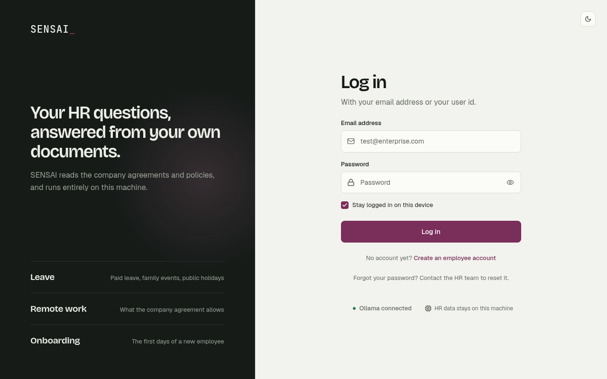 | 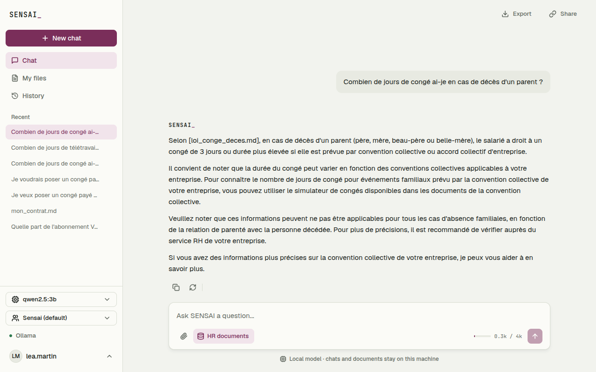 |
| **Leave request waiting for confirmation ([A3])** | **History, with the model of each chat** |
| 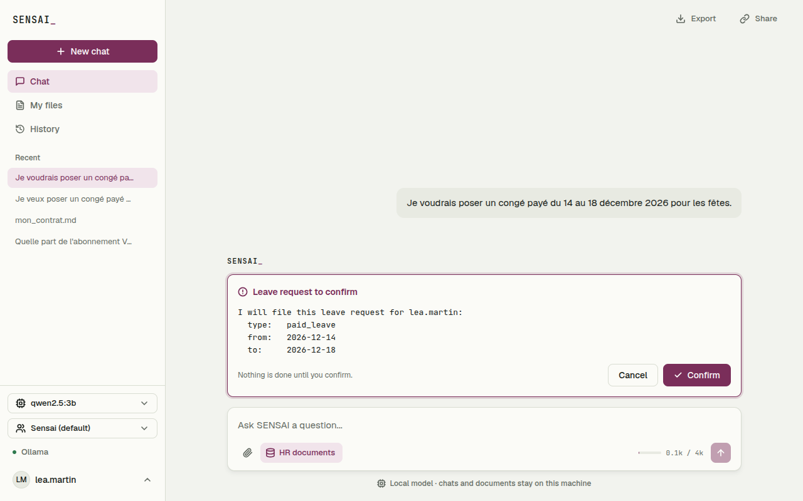 | 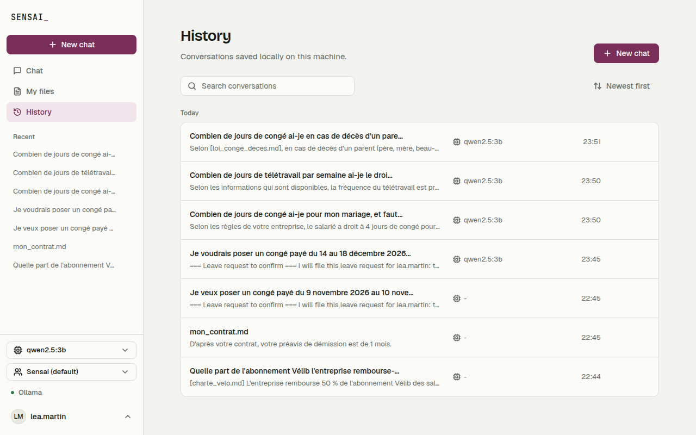 |

<p align="center">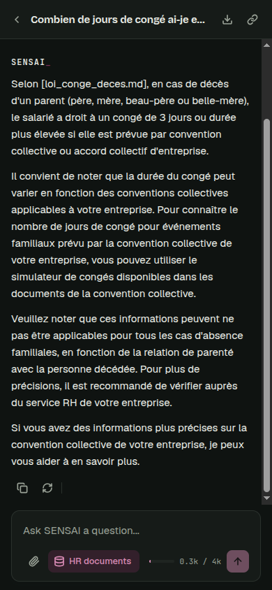</p>

- Log in with your email or your user id. "Create an employee account" on the login page signs up a new employee
  (user id of 3 to 40 letters, digits, `.`, `_` or `-`; a valid email; a password of 8 characters at least) and
  logs them in. The role is always Employee: HR accounts are only created in the CLI.
- Answers stream word by word; the gauge under the composer shows the context used against
  `CONTEXT_TOKEN_BUDGET`. When the agent used tools, "Reasoning" above the answer opens its steps.
- Model, persona, temperature and answer length are changed live, with the same checks as `/model`,
  `/persona` and `/settings` (persona: sidebar and Settings; the chat history is kept).
- History: search, sort, rename, delete (also from the "⋯" menu of each recent chat in the sidebar), and the model of
  the last answer of each chat. The "HR documents" switch of the composer turns the search in the HR documents off
  and on (`/settings documents off|on` in the CLI); while it is off, the semantic cache is not used.
  The sidebar depends on the account ([M1]). An employee has **My files**: the files they joined to their chats
  (each one opens its chat, or is deleted after a confirmation) and the HR documents, read only. HR has an **HR** group: **Knowledge base** (the files
  of `data/docs`, whether they are indexed, importing new ones, and renaming or deleting one from its "⋯" menu,
  see the RAG section) and **Leave requests**. An HR account shows an **HR** badge next to its name (sidebar) or
  next to the logo (phones and tablets).
- Typing `/` in the composer lists the slash commands with what they do; they run on the same code as
  the CLI (`POST /api/command`), and the output is shown in the chat without being saved.
- Desktop: a left sidebar (sections, recent chats, model, Ollama status). Clicking the account opens a
  menu (Profile, Settings, Log out); Profile and Settings open in a tabbed window over the current page.
  Phones and tablets: a tab bar, with a swipe between the same sections, and Settings and
  Profile as full pages.
- Export and Share above the chat (in the app bar on phones and tablets): download the chat shown as
  Markdown, JSON or PDF, or create a public link (`#/share/<token>`). The link opens without logging in,
  read only, and shows a copy of the chat as it was when it was shared; it expires after 7 days, and
  "Stop sharing" or deleting the chat turns it off at once. It never shows who shared it. The server only
  listens on this machine by default, so the link opens on this machine (or your network, if you set
  `WEB_HOST`).
- Light, dark or system theme.
- The server listens on `127.0.0.1` only (`WEB_HOST`, `WEB_PORT` in `.env`).

- Profile (account menu, or `#/profile` on phones): the profile used by every answer, with a preview of the exact
  text sent to the model. It is the same profile as `/profile` in the CLI.
- Leave requests (`#/leaves`, HR accounts only): every employee's requests (employee and email, type, period,
  reason, date filed, status), with a search and filters by type and status; a table on desktop, cards on phones.
  HR approves or refuses each request from the status menu (back to Pending undoes it); who decided is shown
  under it and stored. A request the employee cancelled is final: it shows a badge, and the server refuses (409)
  to decide on it. The employee sees the decision with `/leaves`.
  The section is only shown to HR accounts, and the server refuses the data to anyone else (403): hiding the menu
  is not the protection.

| Employee: My files | HR: Leave requests |
| --- | --- |
| 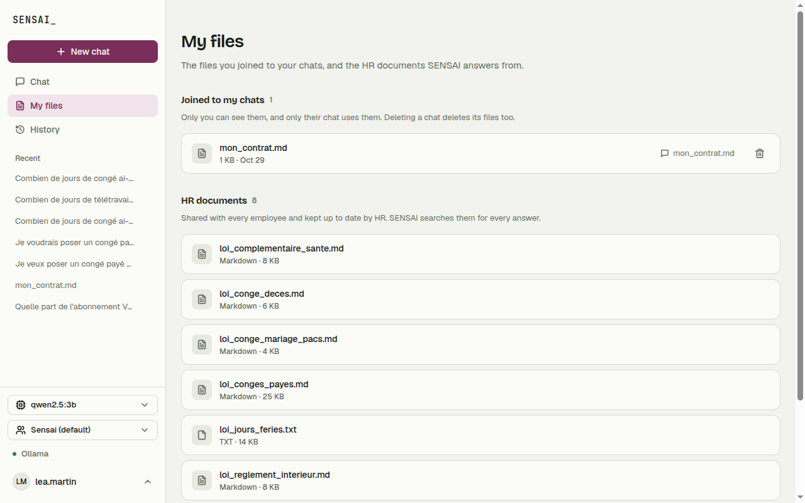 | 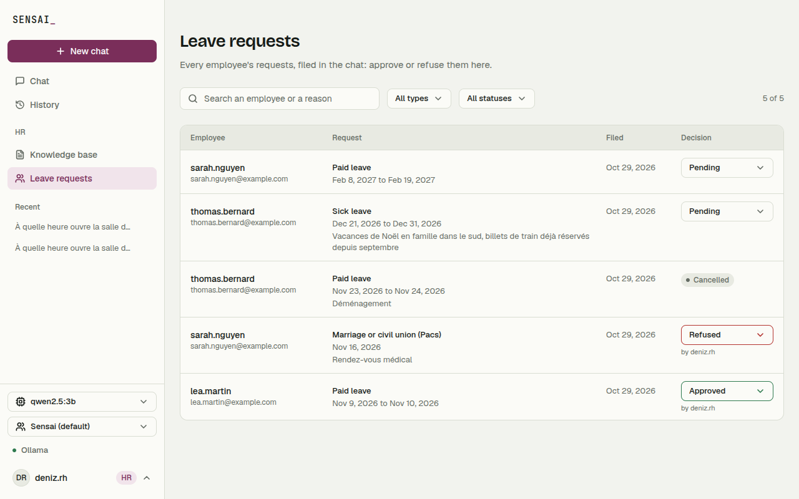 |
| **Export ([X3])** | **Public link ([X3])** |
| 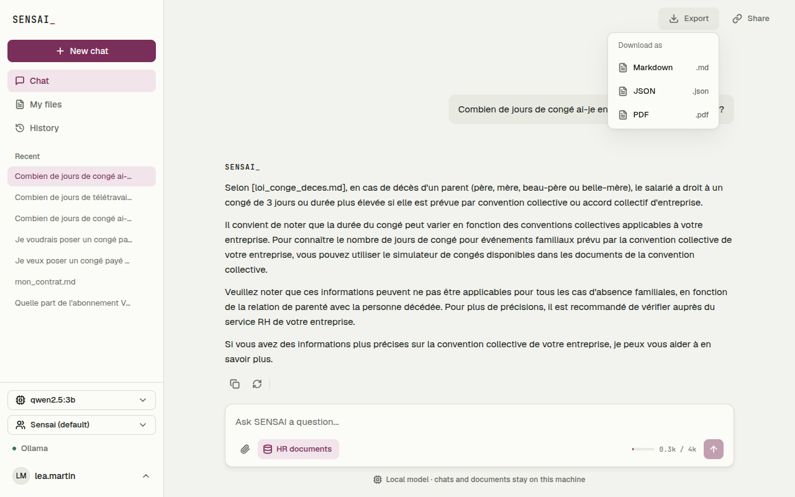 | 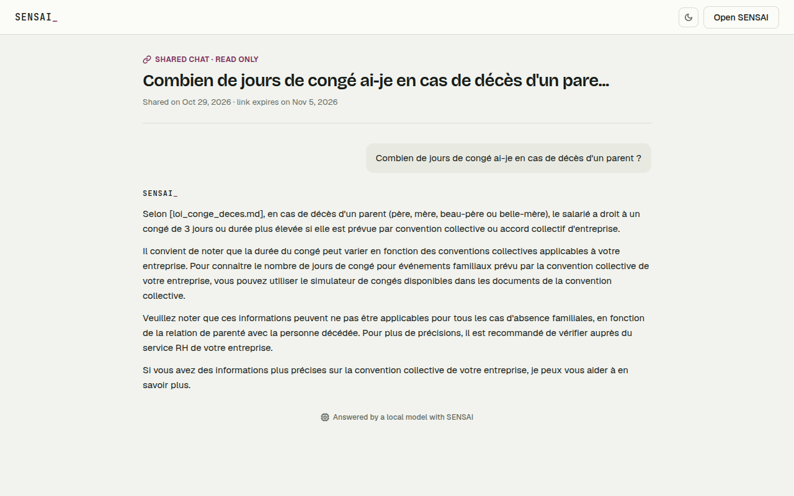 |

The front end (`front/`) is React 18 with Vite, in JavaScript (JSX). Each component has its CSS Module
next to it; only the design tokens, fonts and a few utilities are global (`src/styles/`):

```
front/src/
├── main.jsx, App.jsx    # entry point, routes (#/chat, #/files, #/documents, #/leaves, #/history, #/settings, #/profile, #/share), error screen
├── context/             # AppContext: user, Ollama status, models, context gauge, recent chats
├── api/                 # every call to the backend: HTTP and streaming helpers, one file per domain
├── lib/                 # shared helpers: formats, theme, safe Markdown rendering
├── components/          # shared components: ui/ (Button, Field, Dialog...) and feedback/ (EmptyState...)
├── layout/              # AppShell, left sidebar, mobile app bar and tab bar, Page, slide transitions
└── features/            # one folder per domain, with its pages and components:
                         # auth, chat, export, ollama, personas, history, documents, leaves, settings, profile, account, errors
```

Front tests (Vitest, no server or Ollama needed) sit next to the file they test:

```bash
cd front && npm test
```

## RAG: answers from your HR documents

The assistant can answer from your own documents (HR policies, agreements, legal fact sheets).
Everything runs locally: embeddings are computed by Ollama and stored in the SQLite database.

### Setup

Pull the embedding model once:

```bash
ollama pull bge-m3
```

Then, in the chatbot, index the documents of `data/docs` (or any folder):

```
You: /ingest
Indexing .../data/docs... (can take a minute the first time)
8 document(s) indexed (69 chunks), 0 unchanged, 0 removed.
```

Run `/ingest` again after adding, editing or deleting documents: only changed files are
processed again, and deleted files are removed from the index.

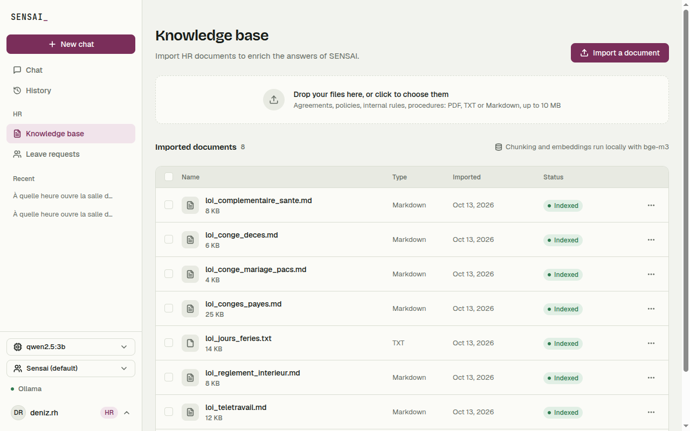

In the web interface, **Knowledge base > Import a document** (HR group of the sidebar) (or a drop on the dashed zone) saves `.txt`, `.md` or
`.pdf` files of up to 10 MB in `data/docs` and runs the same indexing as `/ingest`, on this machine. A file
with no readable text (a scanned PDF) is refused; if Ollama does not answer, the file is kept and indexed by
the next import or `/ingest`. The base is shared by every account, so only **HR accounts** can import or run
`/ingest` (checked by the server, 403 otherwise). An employee sees the list of documents and is pointed to the
files joined to a chat below. Under
Docker, `data/docs` is the `sensai_docs` volume, so imported files survive a rebuild.

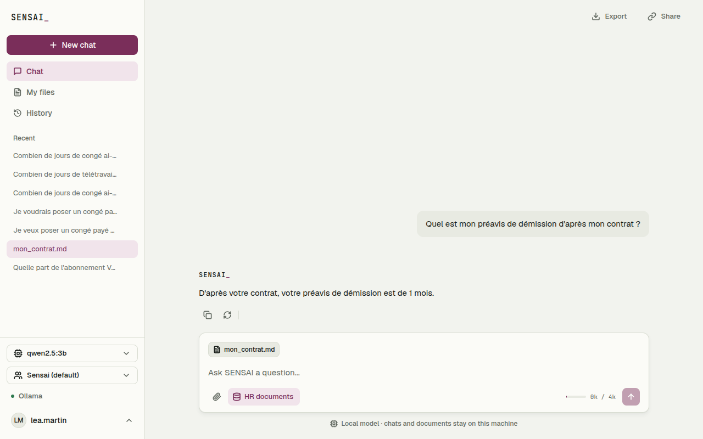

**Files joined to one chat**: the paperclip of the composer joins `.txt`, `.md` or `.pdf` files (10 MB at most)
to the current chat only. They go through the same pipeline but are stored apart (`rag/Attachments.py`):
nobody else sees them, they never enter the shared base, the branches of the chat keep them, and deleting
the chat deletes them. At each question, their passages are ranked by similarity and added, without the
score threshold of the base, until 60 % of the free context is used, then given in file order: a small file
goes in whole (so "summarize the attached file" works), a big one gives its closest passages. A chat with
joined files never uses the semantic cache, and a question about "the file" or "ce document" is answered
without tools, since the text is already in the context.

### Asking questions

Just ask. The most relevant excerpts are added to the model's context for that question only:

```
You: Combien de jours de congé pour un mariage ?
Assistant: Le salarié peut bénéficier d'un congé de 4 jours pour un mariage...
```

A question unrelated to the documents ("Quelle est la recette de la pizza ?") gets no excerpt.

The excerpts are added to the **system message**, as a titled section after the persona and the profile (the
tool guidance comes last). The section describes them instead of giving orders: found automatically, maybe
off-topic, to quote when the question is about them, to ignore otherwise, and never a reason to skip a tool.
An earlier version put them in a second system message right before the question, ending with "say so if they
do not answer": small models then refused leave requests and web searches whenever an excerpt was found
(measured in [docs/benchmarks/chat_models.md](docs/benchmarks/chat_models.md)).

### How it works


| Step     | File                    | What it does                                                                                                           |
| -------- | ----------------------- | ---------------------------------------------------------------------------------------------------------------------- |
| Load     | `back/rag/Loader.py`     | reads .txt / .md / .pdf files, keeps PDF page numbers                                                                  |
| Chunk    | `back/rag/Chunker.py`    | splits text into ~500-token chunks with a 50-token overlap, at paragraph, sentence, line then word boundaries          |
| Embed    | `back/rag/Embeddings.py` | turns each chunk into a vector with Ollama`/api/embed` (`bge-m3`)                                                      |
| Store    | `back/rag/Store.py`      | saves chunks and vectors in SQLite, re-embeds only new or modified files                                               |
| Retrieve | `back/rag/Retriever.py`  | embeds the question, ranks chunks by cosine similarity, keeps the best ones above a threshold, within the token budget |

### Settings (`.env`)


| Variable            | Default            | Meaning                                               |
| ------------------- | ------------------ | ----------------------------------------------------- |
| `RAG_EMBED_MODEL`   | `bge-m3`           | Ollama model used for embeddings                      |
| `RAG_CHUNK_TOKENS`  | `500`              | chunk size, in estimated tokens                       |
| `RAG_CHUNK_OVERLAP` | `50`               | overlap between two chunks, in estimated tokens       |
| `RAG_MIN_SCORE`     | `0.50`             | minimum similarity (0 to 1) for an excerpt to be used |
| `RAG_TOP_K`         | `3`                | maximum number of excerpts per question               |

Changing `RAG_EMBED_MODEL` or the chunk settings requires running `/ingest` again.

### Limits

- Scanned PDFs (images without text) are skipped: there is no OCR.
- The 0.50 threshold was measured with `bge-m3` on the demo documents
  ([docs/benchmarks/embedding_models.md](docs/benchmarks/embedding_models.md)). With other documents or
  another embedding model, measure it again (`nomic-embed-text` needs about 0.70).
- Small chat models do not always cite the source of the excerpts in their answer.

## Project structure

```
sensai/
├── back/
│   ├── Chatbot.py            # startup, login, Ollama call, chat loop
│   ├── Server.py             # web interface entry point (./start.sh --web)
│   ├── Web/                  # FastAPI app, sessions, SSE output, one route file per domain
│   ├── Commands.py           # Session state and the slash commands
│   ├── Memories/             # SQLite: users, conversations, history, compression, token limit
│   ├── Runtime/              # .env loading, personas, models, settings and parameters
│   ├── Agents/               # ReAct loop, tool registry, router, engine, tool providers
│   ├── Tools/                # tools.json, web search, page reader, privacy filter
│   ├── Cache/                # semantic cache: storage, policy, chat glue
│   ├── Export/               # [X3] JSON / Markdown / PDF export (fpdf2, Noto Sans font) and public links
│   ├── rag/                  # loader, chunker, embeddings, store, retriever
│   ├── config/               # system_prompt.txt and personas/ (one JSON file per persona)
│   ├── tests/                # Test_*.py (no real Ollama needed)
│   └── Dockerfile            # image of the API server (docker compose)
├── front/                    # web interface: React + Vite (src/), icons and fonts (public/), Dockerfile + nginx.conf
├── data/docs/                # HR documents for the RAG
├── storage/                  # sensai.db (accounts, conversations, RAG index, cache), not in git
├── docs/                     # user stories (docs/user_stories/) and the HR scenario
├── .env.example              # example configuration (copy to .env)
├── requirements.txt          # Python dependencies
├── install.sh                # sets up venv + dependencies + web build + .env
├── start.sh                  # activates venv and runs the chatbot (--web: web interface)
├── docker-compose.yml        # front + API + Ollama in containers (http://localhost:3000)
└── README.md
```

## Tests

No real Ollama is needed: a small local server plays the part of `/api/chat` and `/api/embed`, and the
database is a temporary file. From the project root:

```bash
source .venv/bin/activate
python -m unittest discover -s back/tests -p "Test_*.py"
```

## Error handling

| Situation | Behavior |
| --- | --- |
| Empty input | Prompts the user again, no request sent |
| Ollama not running | Clear error message, session continues |
| Model unavailable / bad request | Clear error message, session continues |
| Connection dropped mid-stream | Error message, that turn is not saved |
| Context over the token limit | Message refused with the way out (`/new`), or sent with a warning (`TOKEN_LIMIT_ACTION=continue`) |
| Model without tool calling | Answers without tools, one dimmed note |
| A tool fails | The error goes back to the model, which can correct itself |
| Embedding model missing | Semantic cache turned off for the session, one note |

## Known limits

- Everything was tested against a fake Ollama: the real behaviour depends on the model.
- The privacy filter catches patterns (e-mail, phone, social security number, IBAN, card), the account id and
  the profile's name, not any other name.
- The reasoning trace is not saved: after a reload, the answer is shown without it.
- A leave request worded without a leave verb ("je commence le 3 et je termine le 6, raison : deuil") is not
  recognised as one: it keeps the HR excerpts, and a small model then often explains the rules instead of acting.
- Tools and their instructions add about 600 tokens to a message when they are offered.
- Very small models can still get dates wrong or ignore a search result. Below 3B parameters (`llama3.2:1b`), tool
  calling is not reliable: the model often writes the call as text (Sensai recognizes it and runs it), or copies the
  tool's schema instead of a query (the call is refused, the model answers without it). Use `qwen2.5:3b` or larger
  for the agent.
- The persona is not stored per conversation.

## Roadmap

Planned or open: input/output guardrails, telling the employee when HR decides, and an advanced RAG (the passages used under each answer, questions on a selection of documents).

## Team

| Name | Features |
| --- | --- |
| Deniz Demir | [R1] RAG (documents, files joined to a chat), [X1] web interface, [X2] branches and stopping an answer, [X3] export and public links |
| Abdoul-Latif Wabi | [B1] CLI, [M1] accounts, history and profile, [M2] compression and token limit, [A1] ReAct agent, [A5] personas and models, [A6] semantic cache, [T3] web search, leave requests for HR, benchmarks |
| Marc-Antoine Sadio | CI/CD, [A3] human in the loop (leave requests confirmed by the user), answer settings (temperature, seed, length) |
