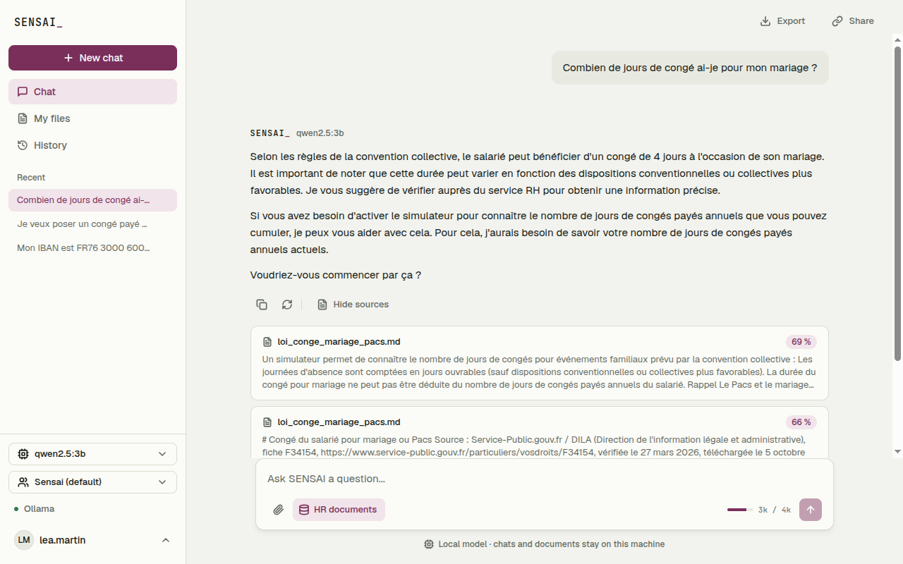

# User Stories : RAG avancé (R2)

## [R2] Reclasser, noter et filtrer les extraits des documents RH

**US-R2-01** En tant que salarié, je veux voir sous chaque réponse les passages des documents RH dont elle vient, avec leur score, afin de vérifier moi-même la règle avant de m'y fier.

Critères d'acceptation :

* Sous une réponse tirée des documents RH, « View sources · N » ouvre la liste des passages utilisés : document, page (PDF), score en pourcentage et extrait ; « Hide sources » la referme
* Au survol, le score détaille sa part de sens et sa part de mots-clés
* Les sources restent après un rechargement de la page, et une branche (X2) garde celles des réponses qu'elle reprend
* Dans la CLI, une ligne grisée `sources: loi_conge_mariage_pacs.md (0.71)` suit la réponse
* `/settings sources off` ou « Show sources » dans Settings les masque ; elles restent enregistrées
* Une réponse sans extrait (question hors sujet, réponse du cache, documents RH coupés) n'a pas de bouton de sources

**US-R2-02** En tant que responsable RH, je veux que les extraits proches mais hors sujet soient écartés avant d'arriver au modèle, afin que l'assistant ne réponde pas à partir d'un passage qui ne concerne pas la question.

Critères d'acceptation :

* Les 10 extraits les plus proches par le sens sont reclassés avec les mots rares de la question qu'ils contiennent ; seul le score final est comparé à `RAG_MIN_SCORE`
* « Quelle est la recette de la pizza ? » n'ajoute aucun extrait ; « Combien de jours pour un mariage ? » ajoute `loi_conge_mariage_pacs.md` en premier
* `RAG_KEYWORD_WEIGHT=0` revient au classement par le sens seul (R1)
* Le choix est mesuré dans `docs/benchmarks/rag_reranking.md` : marge entre bonnes réponses et hors sujet de 0,084 à 0,110 avec `bge-m3` ; le reclassement par le LLM, plus lent (12 s) et moins bon, est écarté

**US-R2-03** En tant que salarié, je veux poser une question sur quelques documents RH seulement, afin d'avoir une réponse tirée de l'accord qui m'intéresse et pas d'un texte voisin.

Critères d'acceptation :

* Dans My files (salarié) ou Knowledge base (RH), je coche des documents puis « Ask about the selection » : une nouvelle discussion s'ouvre
* Une étiquette « Searching only in ... » dans le champ de saisie montre le filtre ; sa croix revient à tous les documents
* Les réponses suivantes ne citent que des passages des documents choisis ; le cache sémantique n'est pas utilisé tant que le filtre est actif
* Dans la CLI, `/scope a.md b.pdf` filtre par nom, `/scope pdf` par type, `/scope off` revient à tous ; un nom inconnu est refusé avec un message clair
* Dans le web, `PUT /api/documents/scope` refuse un document ou un type inconnu (422)

## Captures d'écran

