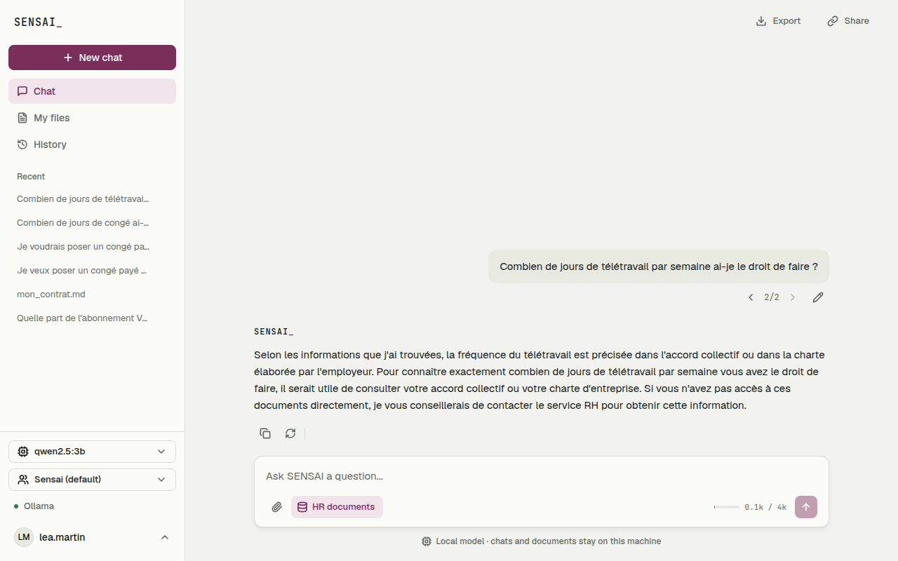

# User Stories : branches et interruption de la génération (X2)

## [X2] Modifier une question sans perdre la discussion d'origine

**US-X2-01** En tant que salarié, je veux modifier une question déjà envoyée, afin d'obtenir une meilleure réponse sans recommencer toute la conversation ni perdre la première version.

Critères d'acceptation :

* Au survol d'une question envoyée, un crayon « Edit » ouvre une zone d'édition avec « Cancel » et « Send » (Entrée envoie, Échap annule)
* « Send » relance la discussion depuis cette question dans une nouvelle branche : les messages d'avant sont gardés, ceux d'après ne sont pas repris
* La conversation d'origine reste intacte ; sous la question, « < 2/2 > » permet de revenir à la version précédente et d'y retourner
* L'historique ne montre qu'une seule entrée pour la conversation et ses branches ; la renommer ou la supprimer agit sur toutes ses branches
* Si la réponse de la branche échoue, la branche n'est pas gardée et « Retry » la relance

**US-X2-02** En tant que responsable RH, je veux redemander une réponse au modèle, afin de comparer deux formulations avant de choisir celle que j'utilise.

Critères d'acceptation :

* « Regenerate » sous une réponse repose la même question au modèle dans une nouvelle branche
* Les réponses obtenues sont accessibles avec « < 1/3 > » sur la question, dans l'ordre où elles ont été produites
* Une réponse régénérée n'efface jamais la précédente

---

## [X2] Arrêter une réponse en cours

**US-X2-03** En tant qu'utilisateur, je veux arrêter une réponse trop longue ou hors sujet pendant qu'elle s'écrit, afin de reformuler ma question sans attendre la fin.

Critères d'acceptation :

* Pendant une réponse, le bouton « Stop » du champ de saisie l'arrête en moins d'une seconde
* Le texte déjà reçu reste affiché avec la mention « Answer stopped », et il est enregistré avec la question
* Une réponse arrêtée n'est jamais servie par le cache sémantique
* Si la réponse est arrêtée avant le premier mot, rien n'est enregistré

**US-X2-04** En tant qu'utilisateur de la CLI, je veux arrêter une réponse avec Ctrl+C sans quitter le programme, afin de continuer la conversation tout de suite.

Critères d'acceptation :

* Pendant une réponse, Ctrl+C l'arrête, affiche « [answer stopped] » et revient à « You: »
* En dehors d'une réponse, Ctrl+C quitte comme avant

## Capture d'écran

Après « Regenerate », la question porte `< 2/2 >` : les flèches passent d'une version à l'autre sans perdre la première.

