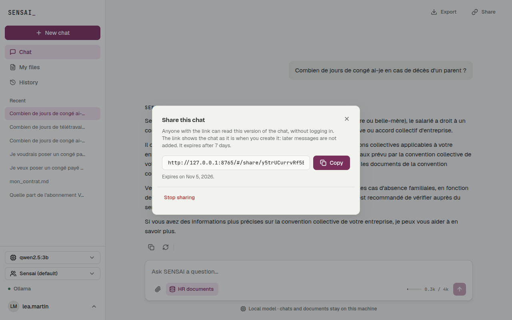

# User Stories : export et lien public (X3)

## [X3] Exporter une discussion

**US-X3-01** En tant que responsable RH, je veux télécharger une discussion en PDF, afin de l'archiver dans le dossier d'un salarié ou de la joindre à un e-mail.

Critères d'acceptation :

* Dans une discussion, « Export » propose Markdown, JSON et PDF ; le choix télécharge aussitôt un fichier `sensai-<id>-<titre>.<format>`
* Le PDF contient le titre, la date d'export, puis chaque message avec son auteur (You ou SENSAI), sa date, et la mise en forme de la réponse (titres, gras, listes)
* Les accents sont corrects ; un caractère que la police ne connaît pas (emoji) devient « ? » au lieu de faire échouer l'export
* Pour une discussion avec des branches (X2), le fichier contient la version affichée, sous le titre de la discussion
* Une discussion sans message, un format inconnu ou la discussion d'un autre compte sont refusés avec un message clair

**US-X3-02** En tant qu'utilisateur de la CLI, je veux exporter la conversation en cours avec une commande, afin de garder une trace sans ouvrir l'interface web.

Critères d'acceptation :

* `/export`, `/export md`, `/export json` ou `/export pdf` écrit le fichier dans `exports/` et affiche son chemin
* Le fichier est identique à celui téléchargé depuis le web (même fonction `Export/Formats.py`)
* Le JSON contient le titre, les dates (ISO 8601, UTC) et chaque message avec son rôle, son texte et sa date
* Dans le composer web, `/export pdf` télécharge le fichier au lieu de l'écrire sur le serveur

---

## [X3] Partager une discussion par un lien public

**US-X3-03** En tant que salarié, je veux envoyer à mon manager un lien vers la réponse que j'ai obtenue, afin qu'il la lise sans avoir de compte SENSAI.

Critères d'acceptation :

* « Share » ouvre une fenêtre : « Create link » crée un lien `#/share/<jeton>` que « Copy » met dans le presse-papiers
* Le lien s'ouvre sans connexion, en lecture seule : titre, date du partage, date d'expiration, questions et réponses, sans aucun bouton pour modifier
* La page publique ne montre ni l'identifiant ni l'e-mail de l'auteur
* Le lien montre la discussion telle qu'elle était au moment du partage : les messages envoyés ensuite n'y apparaissent pas
* Pour une discussion avec des branches, seule la version affichée est partagée

**US-X3-04** En tant que responsable RH soucieux de la confidentialité, je veux que mes liens partagés ne restent pas ouverts indéfiniment, afin de limiter la diffusion de données RH.

Critères d'acceptation :

* Un lien expire 7 jours après sa création ; la page affiche alors « This link has expired. »
* « Stop sharing » coupe le lien tout de suite ; il affiche alors « This link does not exist or was turned off. »
* Créer un nouveau lien pour la même discussion coupe l'ancien
* Supprimer la discussion supprime aussi ses liens
* Le jeton du lien est long et aléatoire (`secrets`), impossible à deviner à partir de l'identifiant de la discussion

## Captures d'écran

| Export (Markdown, JSON, PDF) | Création du lien public |
| --- | --- |
|  |  |

La page publique, ouverte sans connexion, en lecture seule :

